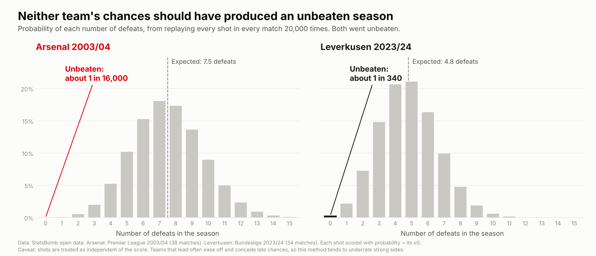
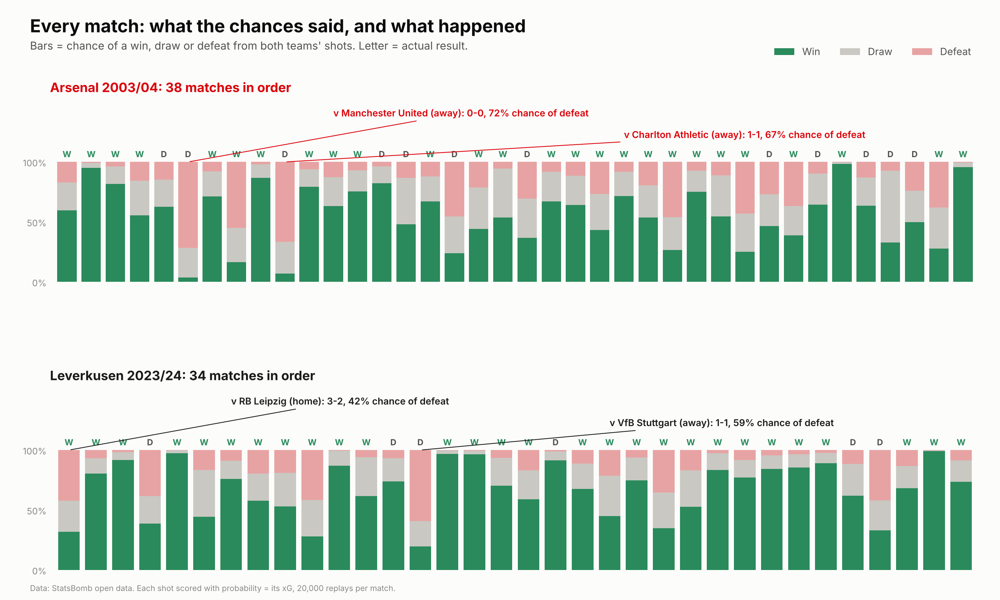
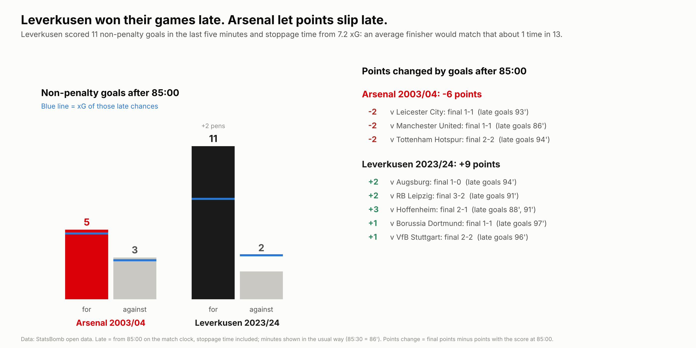
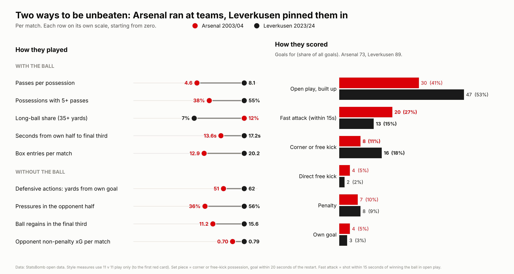
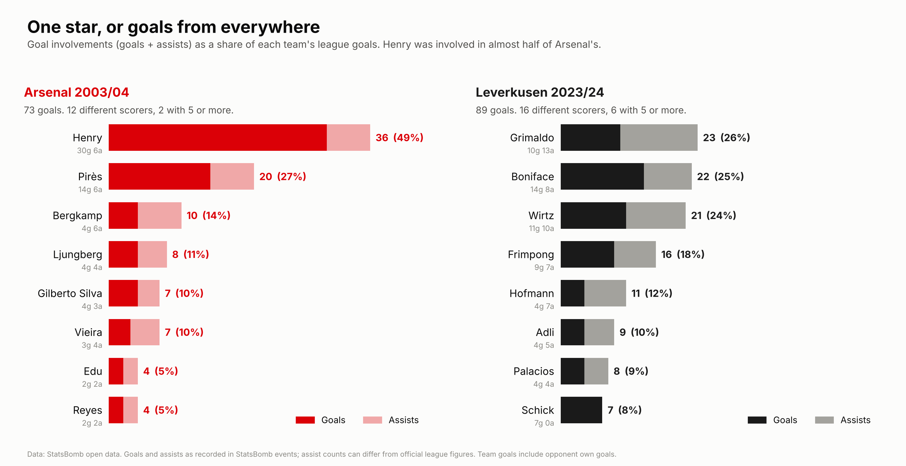

# Two Invincibles, 20 years apart

**Arsenal 2003/04 (Premier League) against Bayer Leverkusen 2023/24 (Bundesliga).**
Both went through a league season unbeaten, and both finished on 90 points. This project uses StatsBomb's free event data to ask four questions:

1. **How likely was it?** If you replay every shot of every match, how often do their chances produce an unbeaten season?
2. **How did they escape?** Time spent behind, comebacks, and goals in the last five minutes.
3. **How did they play?** Two different routes to the same record.
4. **Who did it?** One superstar, or goals from everywhere?



## Key findings

| | Arsenal 2003/04 | Leverkusen 2023/24 |
|---|---|---|
| Record | W26 D12 L0, 73-26 | W28 D6 L0, 89-24 |
| Expected points (from xG) | 72.8 | 74.9 |
| Expected defeats | 7.5 | 4.8 |
| Chance of going unbeaten | about 1 in 16,000 | about 1 in 340 |
| Matches where they went behind | 9 (took 21 of 27 points) | 7 (took 11 of 21 points) |
| Points changed by goals after 85:00 | -6 | +9 |
| Passes per possession | 4.6 | 8.1 |
| Goals within 15 seconds of winning the ball | 20 (27%) | 13 (15%) |
| Corner and free-kick goals | 8 | 16 |
| Top scorer's share of goals | Henry 41% | Boniface 16% |

- **Neither team's chances "should" have produced an unbeaten season.** On xG, Arsenal's most likely number of defeats was 7 and Leverkusen's was 5. Arsenal's record is much further from what its chances predicted.
- **Leverkusen won games late. Arsenal let points slip late.** Leverkusen scored 11 non-penalty goals after 85:00 from 7.2 xG (about a 1 in 13 chance with average finishing), worth +9 points. Arsenal's late goals matched their late xG, and late equalisers cost them 6 points.
- **Two styles.** Arsenal were quicker from their own half to the final third, played more long balls and scored over a quarter of their goals within 15 seconds of winning the ball. Leverkusen kept the ball for longer, entered the box far more often, defended 11 yards higher up the pitch and scored twice as many set-piece goals.
- **Defensively almost identical.** Opponents created about 0.7 to 0.8 non-penalty xG per match against both (11 v 11).
- **One star against a shared load.** Henry was involved in 36 of Arsenal's 73 goals (49%). At Leverkusen, six players scored 5 or more and nobody was involved in more than 26%.

## Charts

| Part | Chart |
|---|---|
| 1. How likely was it? |   |
| 2. The escapes |  |
| 3. Two ways to be unbeaten |  |
| 4. The players |  |

## Data

[StatsBomb open data](https://github.com/statsbomb/open-data): every league match of both seasons (38 for Arsenal, 34 for Leverkusen), read straight from the raw GitHub files and cached in `data/` on the first run. The open data only contains these two teams' matches from those seasons, not the rest of either league, so every comparison here is between **these two teams**, not between two eras of football.

## Method

**Part 0, data audit.** Every score is rebuilt from the events and checked against the match file (72 of 72 match). Red cards, penalties and match lengths are listed.

**Part 1, match simulation.** Every shot in a match, for both teams and including penalties, is scored with probability equal to its StatsBomb xG. Each match is replayed 20,000 times to give a chance of a win, draw and defeat. The season's chance of going unbeaten is the product of (1 - P(defeat)) across all matches, and the full distribution of defeats is built exactly (Poisson-binomial). A stricter possession version combines shots in the same possession into one chance, 1 - product(1 - xG), so rebounds are not counted twice.

**Part 2, game state.** The score at every moment of each match, from the goal events. Late = from 85:00 on the match clock, stoppage time included. Minutes are shown in the usual way (85:30 = 86'). "Points changed" = final points minus points with the score at 85:00. The late finishing test compares non-penalty late goals with non-penalty late xG.

**Part 3, style.** All style measures use 11 v 11 play only (up to the first red card) in normal time:
- possession = share of time on the ball, from possession start and end times;
- long balls = open-play passes of 35+ yards;
- build-up time = seconds from the start of an open-play possession in their own half to its first touch in the final third;
- defensive height = the average distance from their own goal of pressures, tackles, interceptions and fouls;
- fast attack = a shot within 15 seconds of winning the ball in open play;
- set-piece goal = a goal from a corner or free-kick possession within 20 seconds of the restart (moves that began with a throw-in count as open play).

**Part 4, players.** Minutes come from the Starting XI, substitutions and red cards. Goals and assists are as recorded in StatsBomb events, which can differ from official league figures. Per-90 rates are shown for players with 900+ minutes.

## Checks (`checks.py`, output in `results/checks.txt`)

- **Results:** 72 of 72 scores rebuilt exactly.
- **Simulation:** the exact probability of defeat (no random numbers) agrees with the simulation to within 0.8 percentage points in every match. The exact chance of going unbeaten is 1 in 15,710 for Arsenal and 1 in 342 for Leverkusen.
- **xG calibration:** across every shot in these matches, goals ran 2% above xG in Arsenal's season and 9% above in Leverkusen's.
- **Sensitivity:** the chance of going unbeaten stays between 1 in 12,000 and 1 in 20,000 for Arsenal, and between 1 in 320 and 1 in 360 for Leverkusen, across the possession model, xG scaled by each season's calibration, and xG scaled by 0.9 and 1.1.
- **Red cards:** the 11 v 11 cut barely changes the style measures. The exception is Leverkusen's xG (1.73 per match at 11 v 11, 1.95 including play against 10 men), which is why the cut is used.

## Caveats

- **Game state.** The simulation treats every shot as independent of the score. Teams that lead often ease off and give up late chances, so xG-based expected points tend to underrate strong sides. Both teams led for about half of all minutes.
- **Two teams, not two eras.** Without the rest of each league in the data, differences here are between these two teams.
- **PPDA is left out on purpose.** It counts fouls and tackles, and the 2003/04 matches had far more of both (in the zone PPDA counts, Arsenal's opponents committed 12.6 fouls per match, against 7.9 by Leverkusen's opponents), so it would partly measure refereeing and tackling habits rather than pressing. Pressure height and final-third regains are used instead. It is still computed in `results/style_summary.csv`.
- **xG model.** StatsBomb xG is one model. The data for both seasons was collected after the fact from video, so finer details may be recorded differently from live data.

## Run it

```bash
pip install -r requirements.txt
./run_all.sh
```

The first run downloads around 72 event files from GitHub. Later runs use the cache in `data/`.

| Script | What it does | Output |
|---|---|---|
| `common.py` | data loading, caching, team and red-card helpers | |
| `part0_data_audit.py` | scores, xG, penalties, red cards | `results/matches.csv` |
| `part1_dominance.py` | match simulation, unbeaten probability | `results/match_probabilities.csv`, `results/season_summary.csv` |
| `part1b_charts.py` | part 1 charts | `figures/part1a_*.png`, `figures/part1b_*.png` |
| `part2_escapes.py` | game state, comebacks, late goals | `results/game_state.csv`, `results/late_goals.csv` |
| `part2b_chart.py` | part 2 chart | `figures/part2_late_goals.png` |
| `part3_style.py` | style, pressing, goal types | `results/style_*.csv`, `results/goal_types.csv` |
| `part3b_chart.py` | part 3 chart | `figures/part3_two_styles.png` |
| `part4_players.py` | player minutes, goals, assists, xG, xA | `results/players.csv` |
| `part4b_chart.py` | part 4 chart | `figures/part4_players.png` |
| `checks.py` | all checks above | `results/checks.txt` |

---

Data: [StatsBomb open data](https://github.com/statsbomb/open-data). Analysis by Rafiz Rayhan ([GitHub](https://github.com/rafizrayhan), [LinkedIn](https://www.linkedin.com/in/rafiz-rayhan)).
